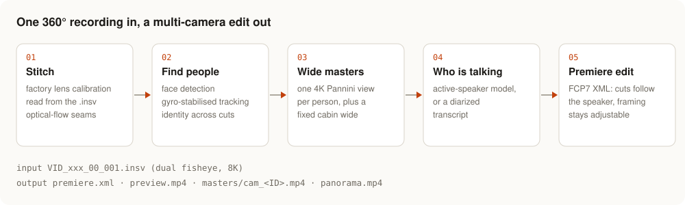
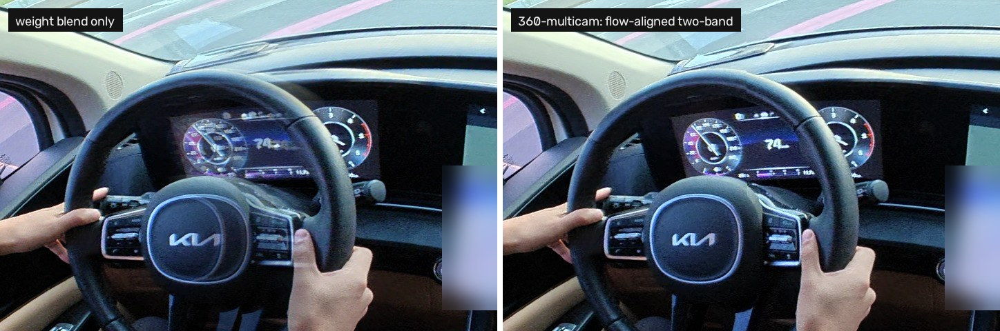
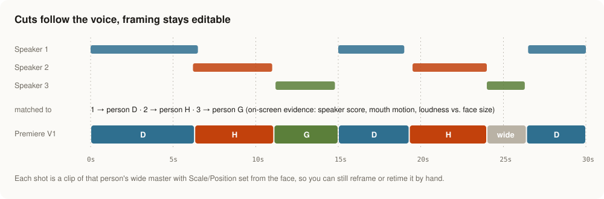
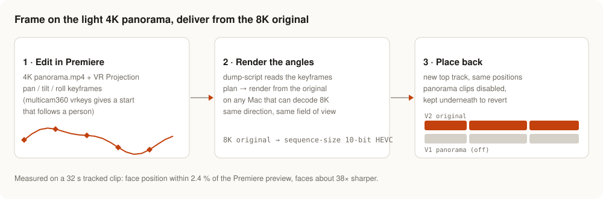

# 360-multicam

Turn one 360° video into a multi-camera edit: the camera sits in the middle of a conversation, and you get a Premiere sequence that cuts to whoever is speaking.



`multicam360` reads an Insta360 `.insv` file, stitches it with the camera's own factory calibration, finds the people, renders a 4K wide master per person, detects who is speaking, and writes a Premiere Pro sequence (FCP7 XML) where every cut follows the speaker and every shot carries a Scale/Position framing you can still adjust without re-rendering.

Two modes:

| Mode | For | How the angles stay on people |
|---|---|---|
| `table` | Camera standing still (table, tripod) | Fixed angle per person, framing per shot from face position |
| `track` | Hand-held, in a car, walking | Gyro stabilisation + horizon levelling, then each person's face is re-detected and followed with a smoothed path |

## Stitching

The camera writes its factory lens calibration into every `.insv`. multicam360 reads it, projects both fisheyes with that model, and aligns the overlap with optical flow, so people sitting on the seam stay one person instead of a transparent double. The same seam treatment runs on moving views (tracking angles, the panorama swap below).



<sub>Same frame, same crop across the lens seam. Left: weight blend only. Right: multicam360's flow-aligned two-band blend. Measurements in [docs/STITCH_QUALITY.md](docs/STITCH_QUALITY.md).</sub>

## Install (macOS, Apple Silicon)

```bash
brew install ffmpeg uv
scripts/setup.sh
```

## Use

```bash
python -m multicam360 probe VID_xxx_00_001.insv                   # camera, calibration format, duration
python -m multicam360 all VID_xxx_00_001.insv --range 4-00:7-00 --out out/   # table mode
python -m multicam360 all VID_xxx_00_001.insv --mode track --out out/        # hand-held / car
python -m multicam360 status out/                                  # stage-by-stage state (JSON with --json)
```

Output (`out/`): `premiere.xml` (import in Premiere), `premiere_shots.json`, `preview.mp4` (same framing as the XML, for review without Premiere), `masters/cam_<ID>.mp4` (4K Pannini-projected wide masters), `manifest.json`.

Re-running skips finished stages; `--set xml.face_ratio=0.28` re-runs only what the change affects. Long jobs can run on another Mac: `--host <ssh-host>`.

In `track` mode a car-interior wide angle (`masters/cam_wide.mp4`, 110°) is rendered too; it stays fixed to the cabin while the camera shakes (`--set masters.wide_hfov=0` to skip).

## Speaker cuts from a diarized transcript

If you already have a diarized transcript (Soniox token JSON), `multicam360` can use it instead of guessing who speaks from the picture alone:

```bash
python -m multicam360 diarize out/ transcript.json            # → out/cut_diar.json
python -m multicam360 diarize out/ transcript.json --map 1=D  # pin speaker 1 to person D
python -m multicam360 all VID_xxx_00_001.insv --out out/ --diar transcript.json   # same thing inside the pipeline
```



Each speaker is matched to one person from on-screen evidence (active-speaker score, mouth motion, loudness against face size), with one speaker per person even when tracking split someone into two IDs.

## Reframe in Premiere, render from the original

Premiere struggles with the 8K original, so frame your shots on the 4K `panorama.mp4` with the VR Projection effect and swap in full-quality renders at the end:



```bash
python -m multicam360 vrkeys out/ D --hfov 70           # pan/tilt/roll keyframes that follow person D (ExtendScript)
python -m multicam360.swap dump-script --sequence "Edit"  # run in Premiere, save the result as dump.json
python -m multicam360.swap plan dump.json plan.json
python -m multicam360.swap render plan.json renders/      # on a machine that can decode the original
python -m multicam360.swap place-script results.json "Edit"   # new top track, same positions, panorama clips disabled
```

The swap renders use the same seam treatment as the panorama, including optical-flow alignment while the view moves.

## Configuration (optional)

`~/.config/multicam360/config.json` (each key can also be an environment variable):

| Key | Env | Used for |
|---|---|---|
| `remote_host` | `MULTICAM360_REMOTE_HOST` | default host for remote test runs (`tests/*.sh --remote`) |
| `remote_dir` | `MULTICAM360_REMOTE_DIR` | code location on the remote host (default `multicam360`) |
| `nas_host` | `MULTICAM360_NAS_HOST` | ssh host for `nas:/path/...` inputs (only the requested range is copied) |
| `nas_ffmpeg` | `MULTICAM360_NAS_FFMPEG` | ffmpeg on the NAS (default `/usr/bin/ffmpeg`) |
| `test_nas_src` | `MULTICAM360_TEST_NAS_SRC` | an `.insv` on the NAS for the NAS probe test |

`MULTICAM360_MAX_ENC` / `MULTICAM360_MAX_DEC` cap concurrent VideoToolbox encoders/decoders (default 4/2) if rendering fails with "Could not open encoder" or "No frame decoded".

## Premiere panel

`plugin/` is a UXP panel (Premiere 25.6+): load `premiere_shots.json`, jump between shots, apply the automatic framing, nudge Scale/Position of the selected clip. See `plugin/README.md`.

## Accuracy and limits

- Speaker detection accuracy depends on the scene; measure it on your footage with `labeler/label.html` (phone-friendly: `labeler/make_mobile_clip.py` builds a face-tile clip; hold a face while that person speaks) + `python -m multicam360 eval`.
- FCP7 `center` is written as half the intended offset: Premiere Pro 26.5 maps it to Position = 0.5 + 2 × center (verified ≤1.1 px against `preview.mp4`).
- Calibration format: Insta360 X6 (`offset_v6`) verified. Other models report `supported: false` from `probe`.
- Rotation-only stabilisation cannot remove parallax of objects very close to the camera.
- Everything runs locally (or on a Mac you point `--host` at over ssh). Nothing is uploaded; a diarized transcript is only read if you pass one.

More: stitch quality against the vendor's own export and what changed it (`docs/STITCH_QUALITY.md`), calibration format notes (`re/README.md`).

License: MIT. Third-party components: see `THIRD_PARTY.md`.

multicam360 is an independent project, not affiliated with or endorsed by Insta360. Insta360 is a trademark of Arashi Vision Inc.
